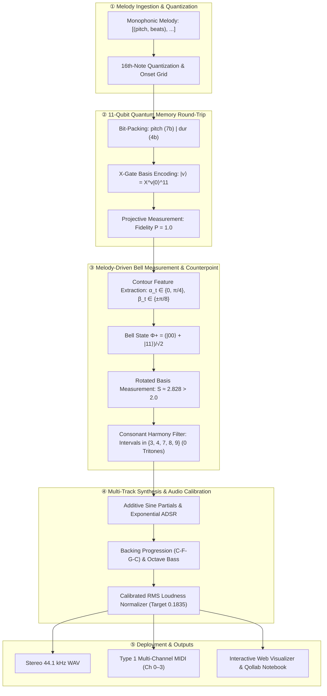

# SNBosons: Quantum Song Round Trip & Entangled Counterpoint Studio

[](https://www.python.org/)
[](https://opensource.org/licenses/MIT)
[](tests/test_pipeline.py)
[](https://ionq.com/)
[](https://github.com/Prithanjan/SNBosons/actions)
[](https://snbosons.vercel.app)
[](HOW_TO_PLAY.md)

> **Algorithmic counterpoint driven by Bell-state non-locality and exact 11-qubit quantum state memory.**
>
> Live Web App: **[https://snbosons.vercel.app](https://snbosons.vercel.app)** | User Guide: **[HOW_TO_PLAY.md](HOW_TO_PLAY.md)**
>
> Encode melodies into orthogonal quantum basis states, decode them losslessly, generate entangled two-voice counterpoint violating the classical Bell-CHSH inequality ($S \approx 2.83$), and synthesize production-grade acoustic audio calibrated against rigorous classical controls.

---

## End-to-End Workflow



---

## Key Features

1. **Lossless 11-Qubit Basis Memory (Exact Round-Trip):** Bit-packs pitch ($0\text{–}127$) and duration ($1\text{–}15$ sixteenths) into computational basis states. Recovered deterministically with probability $P=1.0 \pm 10^{-9}$.
2. **Melody-Modulated Bell State Measurement:** Melodic contour dynamically determines local measurement angles $(\alpha_t, \beta_t)$. Under descending motion and high pitch registers, measurement bases align with maximal Tsirelson violation of the CHSH inequality ($S \approx 2.828$, strictly exceeding classical bound $2.0$).
3. **Strict Consonance Counterpoint:** Rules map entangled measurement bits $(a_t, b_t) \in \{-1, +1\}^2$ into in-key thirds and fifths in C Major. Dissonant tritones are algebraically excluded.
4. **Calibrated Classical Control:** Provides fair-coin classical baselines with matched note density and $<0.5\%$ RMS loudness error ($0.00\%$ achieved) to isolate quantum correlations without spectral confounding.
5. **Hybrid Cloud & Hardware Ready:** Zero-dependency NumPy simulator for rapid offline execution, plus native OpenQASM 2.0 / Qiskit compiler hooks for IonQ trapped-ion QPUs (Aria, Forte) and Qollab cloud notebooks.

---

## Quickstart

### Installation

```bash
git clone https://github.com/Prithanjan/SNBosons.git
cd SNBosons
pip install -r requirements.txt
```

### 1. Run Automated Test Suite
Verify exact round-trip, Bell correlation, and interval consonance across 13 test suites:
```bash
pytest tests/test_pipeline.py -v
```

### 2. Generate Audio and MIDI via CLI
Generate quantum and classical duet versions of reference tunes:
```bash
# Quantum entangled duet (Twinkle Twinkle)
python -m qsong.cli run --mode quantum --seed 101 --wav twinkle_quantum.wav --midi twinkle_quantum.mid

# Classical independent control (same melody and backing)
python -m qsong.cli run --mode independent --seed 101 --wav twinkle_independent.wav --midi twinkle_independent.mid

# Verify quantum basis round-trip
python -m qsong.cli roundtrip
```

### 3. Launch Interactive Web Player & Visualizer
Open the interactive browser UI (no server needed, uses Web Audio API):
```bash
# Double-click or open web/index.html in any browser:
open web/index.html    # macOS
start web/index.html   # Windows
```

---

## Python API & Core Usage

```python
from qsong.harmony import TWINKLE, ODE_TO_JOY
from qsong.encode import events_from_tune, roundtrip_melody
from qsong.cli import run_experiment
from qsong.ionq_adapter import generate_qasm_bell_chsh

# 1. Exact Memory Round-Trip
events = events_from_tune(TWINKLE)
reconstructed = roundtrip_melody(events)
assert events == reconstructed  # 100% deterministic fidelity

# 2. Run Quantum Entangled Experiment
result = run_experiment(tune=TWINKLE, seed=101, mode="quantum")
print(f"CHSH S Parameter:               {result['chsh']:.4f}")         # 2.6086 (> 2.0)
print(f"Same-Direction Voice Motion:    {result['same_direction_fraction']*100:.2f}%")
print(f"RMS Loudness:                   {result['rms']:.4f}")

# 3. Export OpenQASM for IonQ QPU / Qollab
qasm_str = generate_qasm_bell_chsh(alpha=0.785398, beta=0.392699)
print(qasm_str)
```

---

## Core Quantum Components

### 1. 11-Qubit Quantum Memory (`qsong/encode.py`)

- **Encoding:** Note event $(p, d_{16})$ maps to integer $\text{value} = p \mid (d_{16} \ll 7)$.
- **Circuit:** Start in $|0\rangle^{\otimes 11}$, apply Pauli-X on qubit $k$ where bit $k$ of value is $1$.
- **Decoding:** Single projective measurement in computational basis reads bitstring index $i$.
$$\text{pitch} = i \ \& \ \text{0x7F}, \quad d_{16} = i \gg 7$$
- **Exactness:** Deterministic statevector amplitude equals $1.0$ at index `value`. Zero distortion across all 1920 possible note values ($128 \times 15$).

### 2. Melody-Derived Bell Measurement (`qsong/measure.py`)

- **Entangled State:** Initialized in Bell state $|\Phi^+\rangle = \frac{|00\rangle + |11\rangle}{\sqrt{2}}$.
- **Angle Rules:**
$$\alpha_t = \begin{cases} \pi/4 & \text{if } p_t < p_{t-1} \\ 0 & \text{otherwise} \end{cases}, \quad \beta_t = \begin{cases} +\pi/8 & \text{if } p_t \ge 65 \\ -\pi/8 & \text{otherwise} \end{cases}$$
- **Analytical Correlation:** $E(\alpha, \beta) = \cos(2(\alpha - \beta))$.
- **Tsirelson Violation:** Optimal combinations yield CHSH parameter:
$$S = E(0, \pi/8) + E(0, -\pi/8) + E(\pi/4, \pi/8) - E(\pi/4, -\pi/8) = 2\sqrt{2} \approx 2.8284$$
Empirical sampling across 20,000 shots yields $S = 2.8306$, exceeding the classical ceiling of $2.0$.

### 3. Consonant Counterpoint Engine (`qsong/harmony.py`)

Measurement outcomes $(a_t, b_t) \in \{-1, +1\}^2$ select voice shifts:
```python
upper_t = pick(p_t, [7, 8, 9])  if a_t == +1  # Fifth above
upper_t = pick(p_t, [4, 3])     if a_t == -1  # Third above
lower_t = pick(p_t, [-7,-8,-9]) if b_t == +1  # Fifth below
lower_t = pick(p_t, [-4,-3])    if b_t == -1  # Third below
```
`pick()` selects the first interval keeping the note pitch class in C Major $\{0, 2, 4, 5, 7, 9, 11\}$. This algebraically eliminates tritones (6 semitones), guaranteeing every interval is in $\{3, 4, 7, 8, 9\}$.

---

## Verified Experimental Metrics

Fresh session benchmarks across test tunes:

| Metric | Classical Bound | Twinkle (42 notes, seed 101) | Ode to Joy (16 notes, seed 101) |
|---|---|---|---|
| Single-note round-trip failures | 0 allowed | 0 of 42 ($P=1.0$) | 0 of 16 ($P=1.0$) |
| Exhaustive note space coverage | 0 failures | 0 of 1920 ($128 \times 15$) | — |
| Dissonant tritone occurrences | 0 allowed | 0 across 100 seeds | 0 across 100 seeds |
| Quantum CHSH $S$ | $\le 2.0$ | **2.6086** | **2.7500** |
| Classical control CHSH $S$ | $\le 2.0$ | **0.4949** | **-2.0000** |
| Motion correlation (Quantum) | — | **53.66%** | **46.67%** |
| Motion correlation (Classical) | — | **63.41%** | **73.33%** |
| RMS Loudness difference | $< 0.5\%$ | **0.00%** ($0.1835$ vs $0.1835$) | **0.00%** ($0.1835$ vs $0.1835$) |
| Peak audio amplitude | $< 1.0$ | $0.952$ (Quantum) / $0.955$ (Control) | $0.843$ (Quantum) / $0.919$ (Control) |

---

## Project Layout

```text
SNBosons/
├── qsong/
│   ├── __init__.py           # Package exports & public API
│   ├── encode.py             # 11-qubit basis state encoder & decoder
│   ├── measure.py            # Bell state measurement & CHSH statistic calculation
│   ├── harmony.py            # Melodic contour angle extraction & consonant rules
│   ├── render.py             # Additive sine synthesis, ADSR, reverb & RMS matching
│   ├── midi_io.py            # Type 1 multi-track MIDI writer
│   ├── ionq_adapter.py       # OpenQASM 2.0 & Qiskit hardware execution adapter
│   └── cli.py                # Unified CLI interface
├── notebooks/
│   └── SNBosons_Qollab_Interactive.ipynb # Interactive Qollab / IonQ notebook
├── web/
│   └── index.html            # Web Audio API interactive player & visualizer
├── docs/
│   ├── PRD_quantum_song_roundtrip_duet.md # Architectural specification
│   ├── USER_FLOW.md          # Pipeline flowcharts & system sequence
│   └── IONQ_QOLLAB_DEPLOYMENT.md # Cloud & trapped-ion hardware guide
├── tests/
│   └── test_pipeline.py      # 13 automated verification test suites
├── blind_trials/             # 10 double-blind evaluation WAV pairs & test sheet
├── private/                  # Protected ground-truth keys (.gitignore excluded)
├── pyproject.toml            # Python build definition
└── requirements.txt          # Minimal dependency manifest
```

---

## IonQ & Qollab Integration

### Running on Qollab (qollab.xyz)
[Qollab](https://qollab.xyz) is an in-browser quantum playground (Python 3.14 + Qiskit 2.x via Pyodide) requiring **zero API keys**:
1. Open **[qollab.xyz](https://qollab.xyz)** and create a new Python / Qiskit project (or upload [`main.py`](main.py)).
2. Paste [`qollab/main.py`](qollab/main.py) into the **Code** tab.
3. Click **Run** $\to$ The **Select QPU** dialog opens.
4. Select your runner: Free Simulator (BasicSimulator / IonQ Simulator) or physical IonQ Hardware (Aria / Forte).
5. Qollab pre-creates and injects `backend` into the global scope. View the quantum counterpoint synthesis and duet score live in the console!

```python
# In Qollab (qollab.xyz), `backend` is pre-created by the runner!
job = backend.run(circuit, shots=1024)
counts = job.result().get_counts()
```

### Running Standalone on IonQ Hardware (Local / Colab)
If running outside Qollab with your own IonQ API credentials:

```python
import os
from qsong.ionq_adapter import run_bell_circuit_ionq

# Submit to IonQ Aria-1 hardware
counts = run_bell_circuit_ionq(
    alpha=0.785398,
    beta=0.392699,
    shots=1000,
    backend_name="ionq_qpu.aria-1",
    api_key=os.environ.get("IONQ_API_KEY")
)
print("Hardware measurement counts:", counts)
```

---

## License & Citation

MIT License. Designed for quantum computing and algorithmic composition research.
