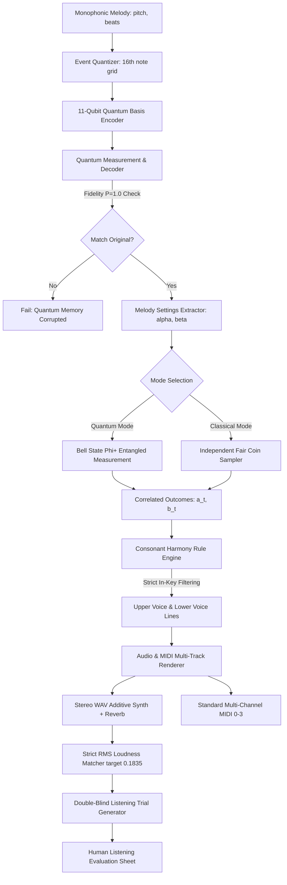

# User Flow & System Pipeline Architecture: SNBosons

## 1. High-Level User Flow

---

## 2. Detailed Pipeline Steps

### Step 1: Melody Intake & Event Conversion
- **Input:** Note sequence `[(pitch, beats), ...]`.
- **Transformation:** Quantize beats into sixteenth notes: $d_{16} = \text{round}(\text{beats} \times 4)$.
- **Validation:** $d_{16} \in [1, 15]$, pitch $\in [0, 127]$. Compute running onsets.

### Step 2: 11-Qubit Quantum Basis Encoding (Memory Round Trip)
- **State construction:** Bit 0–6 for pitch, bit 7–10 for duration.
- **Quantum Execution:** For each note, apply bit-wise Pauli-X gates on $|0\rangle^{\otimes 11}$.
- **Verification:** Measure basis state. Ensure measured probability on target index $i$ satisfies $P(i) = 1.0$ within tolerance $10^{-9}$.

### Step 3: Melody Contour Analysis & CHSH Angle Generation
- For each note event $t$:
  - $\alpha_t = \pi/4$ if $p_t < p_{t-1}$ (pitch downward motion), else $0$.
  - $\beta_t = +\pi/8$ if $p_t \ge 65$ (high register), else $-\pi/8$.
- Yields standard CHSH measurement angles $(\alpha, \beta) \in \{0, \pi/4\} \times \{\pi/8, -\pi/8\}$.

### Step 4: Entangled Measurement vs. Independent Classical Control
- **Quantum:** Measure Bell pair $|\Phi^+\rangle = \frac{|00\rangle + |11\rangle}{\sqrt{2}}$ in basis rotated by $\alpha_t$ and $\beta_t$.
  - Theoretical correlation: $E = \cos(2(\alpha_t - \beta_t))$.
  - Measured CHSH S-statistic approaches $2.828$.
- **Classical Control:** Draw independent uniform random outcomes $a_t, b_t \in \{-1, +1\}$.
  - Single-variable marginal probabilities match ($P = 0.5$).
  - Two-variable correlation $E = 0$ (CHSH $S \le 2.0$).

### Step 5: Counterpoint Harmony Generation (Strict Consonance)
- **Upper Voice:**
  - $a_t = +1 \implies$ select first in-key interval from $\{+7, +8, +9\}$ (fifth above).
  - $a_t = -1 \implies$ select first in-key interval from $\{+4, +3\}$ (third above).
- **Lower Voice:**
  - $b_t = +1 \implies$ select first in-key interval from $\{-7, -8, -9\}$ (fifth below).
  - $b_t = -1 \implies$ select first in-key interval from $\{-4, -3\}$ (third below).
- **Consonance Invariant:** Tritones strictly prohibited; only intervals $\{3, 4, 7, 8, 9\}$ allowed.

### Step 6: Rendering Engine
- **Audio Rendering:**
  - Additive sine wave synthesis with partial harmonics.
  - Exponential decay envelope $\exp(-1.2t)$ with $0.01\text{s}$ attack.
  - Accompaniment: C-F-G-C triad chord progression and bass notes.
  - Reverb: Synthetic room impulse response.
  - Loudness: Root-Mean-Square (RMS) matched within $0.5\%$, peak $< 1.0$.
- **MIDI Rendering:**
  - Channel 0: Lead Melody
  - Channel 1: Chords
  - Channel 2: Bass
  - Channel 3: Harmony Counterpoint

### Step 7: Double-Blind Evaluation
- Generator creates randomized pairs `trial_XX_A.wav` and `trial_XX_B.wav`.
- Secret ground-truth keys stored strictly in `private/trials_key.json` (git-ignored).
- Participant fills `LISTENING_TEST_SHEET.md`.
